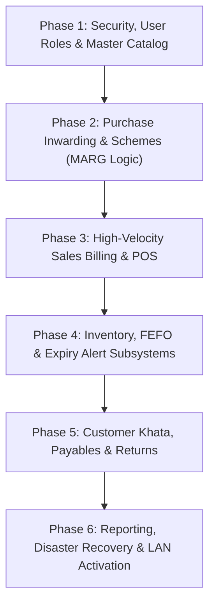

# Comprehensive Implementation Plan: Offline Pharmacy Management System
### Inspired by the Workflow of MARG ERP 9+ (Single-Computer Offline to Local Network LAN)

---

## 1. Executive Summary & Architectural Overview

### 1.1 Objective & Vision
The objective of this project is to build an offline-first, high-velocity pharmacy point-of-sale (POS) and inventory management system designed for Indian retail chemists. The application is inspired by the battle-tested keyboard ergonomics, batch-level precision, and pharmaceutical commercial math of **MARG ERP 9+**, while eliminating legacy drawbacks (accidental bloat, UI ads, DBF file corruption, and lack of intuitive modern design).

The system operates autonomously with **100% offline capability on a single computer**, while providing a seamless architectural upgrade path to **multi-counter local area network (LAN)** operation without requiring an application rewrite.

### 1.2 Target Topology & Architectural Principles
```
 ┌────────────────────────────────────────────────────────────────────────┐
 │                      MASTER WORKSTATION (SERVER / COUNTER 1)          │
 │                                                                        │
 │  ┌──────────────────────┐      ┌────────────────────────────────────┐  │
 │  │ React Web Client UI  │      │   Native Local Background Daemon   │  │
 │  │ (Chromium / Desktop) │◄────►│   (FastAPI / Starlette / Python)   │  │
 │  └──────────────────────┘      └─────────────────┬──────────────────┘  │
 │                                                  │                     │
 │                             ┌────────────────────┼──────────────────┐  │
 │                             ▼                    ▼                  ▼  │
 │                    ┌─────────────────┐  ┌────────────────┐ ┌────────┐  │
 │                    │   SQLite 3 WAL  │  │ Win32 Spooler  │ │ Automated │
 │                    │ Authoritative DB│  │ ESC/POS Thermal│ │ Backup │  │
 │                    └─────────────────┘  └────────────────┘ └────────┘  │
 └──────────────────────────────────────▲─────────────────────────────────┘
                                        │ LAN TCP/IP (HTTP/WS)
                                        │ Bearer JWT / mDNS Discovery
         ┌──────────────────────────────┴──────────────────────────────┐
         ▼                                                             ▼
┌────────────────────────────────┐            ┌────────────────────────────────┐
│  TERMINAL 2 (COUNTER 2 / POS)  │            │  TERMINAL 3 (STORE BACK-OFFICE)│
│  - Chromium App / Browser      │            │  - Stock Inwarding / Purchases │
│  - USB Scanner + Receipt Print │            │  - CA Reports & Master Catalog │
└────────────────────────────────┘            └────────────────────────────────┘
```

1. **Workstation Operational Authority:** The local database on the master PC is the authoritative source of truth. Internet connectivity is never a requirement for core pharmacy operations.
2. **Sub-Second Keyboard-First Ergonomics:** 100% of counter operations (search, batch selection, strip cutting, tender, print) can be completed without a mouse.
3. **Pharma-Native Batch Tracking (FEFO):** Every unit in inventory is linked to a batch number, expiry date, MRP, and landed cost. Earliest-expiring batches are automatically prioritized.
4. **Decoupled Hardware Printing:** Transaction commit is strictly isolated from printer hardware. A printer jam or offline status never rolls back an invoice.
5. **Strict Financial & Regulatory Compliance:** Consecutive invoice sequences (CGST Rule 46), immutable Schedule H1 register, and CA Tax Pack exports.

---

## 2. Technology Stack & Directory Structure

* **Backend Engine:** Python 3.12+ (FastAPI / ASGI with Uvicorn, or hardened async daemon).
* **Authoritative Database:** Embedded **SQLite 3.45+** running in `WAL` mode with `PRAGMA synchronous = NORMAL;`, `PRAGMA foreign_keys = ON;`, `PRAGMA busy_timeout = 10000;`.
* **Search Engine:** SQLite **FTS5** full-text search index for sub-millisecond medicine search across 20,000+ SKUs.
* **Frontend Client:** React 19 + TypeScript + Vite, custom high-contrast CSS (optimized for rapid keyboard usage), Vitest + React Testing Library.
* **Hardware Interfacing:** Win32 Raw Print Spooler (`win32print`) for thermal 80mm ESC/POS receipts, network raw socket printing (port 9100), and PDF generator for A4/A5 laser invoices.
* **Monorepo Layout:**
  ```
  .
  ├── apps/
  │   ├── daemon/          # Python 3.12 background service & engine
  │   │   ├── src/pharmacy_daemon/
  │   │   │   ├── api/     # REST routers, controllers & dependencies
  │   │   │   ├── db/      # SQLite engine, migrations & connection pool
  │   │   │   ├── domain/  # Business math, validation & schemas
  │   │   │   ├── printing/# Win32 & ESC/POS spooler worker
  │   │   │   └── security/# JWT auth, password hashing & RBAC
  │   │   └── tests/       # Unit, integration & workflow tests
  │   └── web/             # React 19 + TypeScript + Vite SPA
  │       ├── src/
  │       │   ├── api/     # Typed API client wrapper
  │       │   ├── components/ # Keyboard-first POS views
  │       │   └── hooks/   # Hotkey listeners & keyboard focus traps
  │       └── tests/       # Component & workflow tests
  ├── packages/
  │   └── api-contracts/   # Shared TypeScript types, schemas & DTOs
  ├── scripts/             # Windows 1-click startup batch scripts
  └── package.json         # Root monorepo configuration
  ```

---

## 3. Phased Implementation Roadmap



---

### Phase 1: Security, User Roles & Master Catalog Management

#### 1. Objectives & Scope
Establish a secure multi-user operational base with Role-Based Access Control (RBAC), and build complete master data management for medicines, manufacturers, suppliers, and customers.

#### 2. Key Deliverables & Specifications
* **User Accounts & RBAC Subsystem:**
  * System roles: `ADMIN` (Store Owner), `PHARMACIST` (Dispenser), `CASHIER` (Billing Operator).
  * Secure password hashing using PBKDF2/bcrypt.
  * Stateless JWT authentication with configurable session expiry.
  * Fast Cashier Switch: 4-digit numeric PIN unlock for quick operator handover at the counter.
  * Permission matrices restricting master price modifications, back-dated adjustments, and backup restores to `ADMIN`.
* **Medicine & Product Master:**
  * Entities: Brand Name, Generic Salt Composition, Dosage Form (`TABLET`, `CAPSULE`, `SYRUP`, `INJECTION`, `OINTMENT`, `DROPS`, `POWDER`, `RESPULES`, `INHALER`), Pack Size (units per strip/bottle).
  * Tax & Statutory Attributes: HSN Code (default `3004`), GST Rate Slab (`0%`, `5%`, `12%`, `18%`, `28%`).
  * Compliance Flags: `is_schedule_h1` (Restricted antibiotics/sedatives), `is_schedule_h` (Prescription required), `is_narcotic` (Schedule X).
  * Storage & Logistics: Rack/Shelf coordinate (`rack_location`, e.g., "A-12"), Reorder Minimum Level (`min_stock_units`), Primary EAN/UPC Barcode.
  * FTS5 Integration: Virtual table synchronizing brand name, generic salt, and manufacturer name for sub-millisecond search.
* **Supplier & Stockist Master:**
  * Entities: Distributor Name, GSTIN (validated against 15-character statutory format), Drug License Form 20B/21B numbers, Phone, Email, Address.
  * Financial Terms: Credit period (days), Credit limit (₹), Current payable balance.
* **Customer Master:**
  * Entities: Patient/Customer Name, Mobile Number, Address, Default Consulting Doctor, Credit Limit (₹), Current Khata Balance.

#### 3. Database Schema (Entities Introduced)
```sql
CREATE TABLE users (
    id INTEGER PRIMARY KEY AUTOINCREMENT,
    username TEXT UNIQUE NOT NULL,
    full_name TEXT NOT NULL,
    password_hash TEXT NOT NULL,
    pin_hash TEXT,
    role TEXT NOT NULL CHECK (role IN ('ADMIN', 'PHARMACIST', 'CASHIER')),
    is_active INTEGER NOT NULL DEFAULT 1,
    created_at TEXT NOT NULL
);

CREATE TABLE manufacturers (
    id INTEGER PRIMARY KEY AUTOINCREMENT,
    name TEXT UNIQUE NOT NULL,
    short_code TEXT,
    created_at TEXT NOT NULL
);

CREATE TABLE suppliers (
    id INTEGER PRIMARY KEY AUTOINCREMENT,
    name TEXT NOT NULL,
    gstin TEXT,
    dl_number_20b TEXT,
    dl_number_21b TEXT,
    phone TEXT,
    email TEXT,
    address TEXT,
    credit_days INTEGER NOT NULL DEFAULT 21,
    current_payable REAL NOT NULL DEFAULT 0.0,
    is_active INTEGER NOT NULL DEFAULT 1,
    created_at TEXT NOT NULL
);

CREATE TABLE medicines (
    id INTEGER PRIMARY KEY AUTOINCREMENT,
    brand_name TEXT NOT NULL,
    generic_salt TEXT NOT NULL,
    dosage_form TEXT NOT NULL,
    pack_size INTEGER NOT NULL DEFAULT 1,
    manufacturer_id INTEGER REFERENCES manufacturers(id),
    hsn_code TEXT NOT NULL DEFAULT '3004',
    gst_rate REAL NOT NULL DEFAULT 12.0,
    is_schedule_h1 INTEGER NOT NULL DEFAULT 0,
    is_schedule_h INTEGER NOT NULL DEFAULT 1,
    is_narcotic INTEGER NOT NULL DEFAULT 0,
    min_stock_units INTEGER NOT NULL DEFAULT 10,
    rack_location TEXT,
    barcode TEXT,
    is_active INTEGER NOT NULL DEFAULT 1,
    created_at TEXT NOT NULL,
    updated_at TEXT NOT NULL
);

CREATE TABLE customers (
    id INTEGER PRIMARY KEY AUTOINCREMENT,
    name TEXT NOT NULL,
    phone TEXT,
    address TEXT,
    default_doctor TEXT,
    credit_limit REAL NOT NULL DEFAULT 5000.0,
    current_balance REAL NOT NULL DEFAULT 0.0,
    created_at TEXT NOT NULL
);
```

#### 4. Acceptance Criteria
* [x] Admin can create user profiles with distinct roles and PINs.
* [x] Non-authenticated or Cashier-level tokens cannot update master medicine rates or access restricted endpoints.
* [x] Fast full-text search query `<10ms` over 10,000 medicine catalog rows.
* [x] Automatic validation of 15-character GSTIN format.

---

### Phase 2: Purchase Inwarding & Schemes (MARG Logic)

#### 1. Objectives & Scope
Implement the pharmaceutical purchase inwarding workflow modeled after MARG ERP, including complex trade discounts, free schemes ($10+1$), non-inventory charges, and amortized landed cost calculations.

#### 2. Key Deliverables & Specifications
* **Keyboard-Driven Purchase Inwarding Grid (F3):**
  * Rapid tabular entry with auto-advancing `Enter` progression:
    $$\text{Medicine} \longrightarrow \text{Batch No} \longrightarrow \text{Expiry (MM/YY)} \longrightarrow \text{Paid Packs} \longrightarrow \text{Free Packs} \longrightarrow \text{PTR} \longrightarrow \text{MRP} \longrightarrow \text{TD\%} \longrightarrow \text{GST\%}$$
  * Duplicate bill protection: Inwarding blocks identical `(supplier_id, supplier_invoice_number)` combinations.
* **Pharma Scheme Engine & Math:**
  * Handles Free schemes ($10+1$, $100+15$, Half Scheme, Full Scheme).
  * Multi-tier discounts: Trade Discount (TD%) and Cash Discount (CD%).
  * Landed Cost Formula per fundamental unit (e.g. per tablet/capsule):
    $$\text{Taxable Basis} = (\text{Paid Packs} \times \text{PTR}) \times (1 - \frac{\text{TD}\%}{100})$$
    $$\text{Net Tax} = \text{Taxable Basis} \times \frac{\text{GST}\%}{100}$$
    $$\text{Total Units} = (\text{Paid Packs} + \text{Free Packs}) \times \text{Pack Size}$$
    $$\text{Landed Cost per Unit} = \frac{\text{Taxable Basis} + \text{Net Tax}}{\text{Total Units}}$$
* **Freight & Surcharge Line Items:**
  * Support for non-inventory line items (e.g., freight, cold-chain ice box charges, distributor handling fees).
  * System invoice grand total reconciles exactly with distributor paper bill.
* **Automatic Inventory Inwarding & Payables:**
  * Atomic insertion into `batches` with updated stock units.
  * Direct credit to supplier ledger: $\text{Current Payable} = \text{Current Payable} + \text{Grand Total}$.

#### 3. Database Schema (Entities Introduced)
```sql
CREATE TABLE purchase_invoices (
    id INTEGER PRIMARY KEY AUTOINCREMENT,
    supplier_id INTEGER NOT NULL REFERENCES suppliers(id),
    supplier_invoice_number TEXT NOT NULL,
    invoice_date TEXT NOT NULL,
    received_date TEXT NOT NULL,
    subtotal_taxable REAL NOT NULL,
    total_cgst REAL NOT NULL,
    total_sgst REAL NOT NULL,
    total_igst REAL NOT NULL DEFAULT 0.0,
    freight_charges REAL NOT NULL DEFAULT 0.0,
    round_off REAL NOT NULL DEFAULT 0.0,
    grand_total REAL NOT NULL,
    payment_status TEXT NOT NULL DEFAULT 'UNPAID' CHECK (payment_status IN ('PAID', 'UNPAID', 'PARTIAL')),
    created_by INTEGER REFERENCES users(id),
    created_at TEXT NOT NULL,
    CONSTRAINT uq_supplier_invoice UNIQUE (supplier_id, supplier_invoice_number)
);

CREATE TABLE purchase_items (
    id INTEGER PRIMARY KEY AUTOINCREMENT,
    purchase_invoice_id INTEGER NOT NULL REFERENCES purchase_invoices(id) ON DELETE CASCADE,
    batch_id INTEGER NOT NULL REFERENCES batches(id),
    paid_packs INTEGER NOT NULL,
    free_packs INTEGER NOT NULL DEFAULT 0,
    pack_size INTEGER NOT NULL,
    purchase_rate REAL NOT NULL,
    trade_discount_percent REAL NOT NULL DEFAULT 0.0,
    taxable_amount REAL NOT NULL,
    gst_rate REAL NOT NULL,
    cgst_amount REAL NOT NULL,
    sgst_amount REAL NOT NULL,
    total_amount REAL NOT NULL,
    effective_landed_cost_per_unit REAL NOT NULL
);
```

#### 4. Acceptance Criteria
* [x] Inwarding 10 packs @ ₹100 PTR with 1 Free pack correctly yields 110 units at amortized landed cost.
* [x] Purchase entry completes entirely via keyboard without mouse navigation.
* [x] Supplier current balance increments atomically with purchase bill submission.
* [x] Idempotency keys prevent double invoice submission.

---

### Phase 3: High-Velocity Sales Billing & POS

#### 1. Objectives & Scope
Deliver sub-second, keyboard-driven counter sales matching MARG ERP billing speed, featuring FEFO batch auto-picking, loose blister cutting, split tender, and bill hold/recall.

#### 2. Key Deliverables & Specifications
* **Sub-Second Keyboard Billing Workflow (F1):**
  * Auto-focus medicine search on opening bill.
  * Barcode scanner wedge input support ($\le 30\text{ ms}$ inter-character delay auto-detection).
  * Direct key progression: Item Search $\rightarrow$ Batch $\rightarrow$ Qty $\rightarrow$ Line Add.
* **Loose Tablet Blister Cutting (Fractional Dispensing):**
  * Support for slash syntax (e.g. typing `/5` on a 10-pack strip inputs 5 individual tablets).
  * System calculates unit pricing based on pack MRP and updates fundamental stock units accurately.
* **Substitute Medicine Finder (`Alt+S` or `F3`):**
  * When a requested brand is out of stock, pressing `Alt+S` immediately lists all in-stock products with identical generic salts and dosage forms.
* **Multi-Cart Bill Hold & Recall (`Ctrl+H` / `Ctrl+R`):**
  * Cashier can park an active bill into the held queue when a customer steps away.
  * Cashier attends to subsequent customers and recalls the held bill without data loss.
  * In-memory cart state automatically mirrors to local browser storage to prevent loss on refresh.
* **Split-Tender Payment Modal (`F9` / Tender):**
  * Multi-method payment: Cash, UPI, Card, and Customer Khata split.
  * Quick cash presets (₹100, ₹200, ₹500) and change calculation.
  * Direct Khata charging with credit limit validation.
* **Statutory Schedule H1 Capture:**
  * Mandatory prompt for Prescribing Doctor and Patient Name/Address when any Schedule H1 drug is added to the cart.
* **Thermal Printing (80mm ESC/POS) & Laser (A4/A5 PDF):**
  * Decoupled asynchronous spooling to Win32 printer queue.
  * ESC/POS commands: Bold headers, item table, tax breakdown, drug license print, and cash drawer kick pulse (`ESC p 0 25 250`).
  * Option to toggle standard A4/A5 PDF invoice format for institutional or B2B sales.

#### 3. Database Schema (Entities Introduced)
```sql
CREATE TABLE sale_invoices (
    id INTEGER PRIMARY KEY AUTOINCREMENT,
    invoice_no TEXT UNIQUE NOT NULL,
    fiscal_year TEXT NOT NULL,
    customer_id INTEGER REFERENCES customers(id),
    doctor_name TEXT,
    doctor_address TEXT,
    subtotal_taxable REAL NOT NULL,
    total_cgst REAL NOT NULL,
    total_sgst REAL NOT NULL,
    total_igst REAL NOT NULL DEFAULT 0.0,
    round_off REAL NOT NULL DEFAULT 0.0,
    grand_total REAL NOT NULL,
    payment_mode TEXT NOT NULL CHECK (payment_mode IN ('CASH', 'UPI', 'CARD', 'KHATA', 'SPLIT')),
    cash_tendered REAL DEFAULT 0.0,
    change_returned REAL DEFAULT 0.0,
    status TEXT NOT NULL DEFAULT 'COMPLETED' CHECK (status IN ('COMPLETED', 'CANCELLED')),
    created_by INTEGER REFERENCES users(id),
    created_at TEXT NOT NULL
);

CREATE TABLE sale_items (
    id INTEGER PRIMARY KEY AUTOINCREMENT,
    sale_invoice_id INTEGER NOT NULL REFERENCES sale_invoices(id) ON DELETE CASCADE,
    batch_id INTEGER NOT NULL REFERENCES batches(id),
    quantity_units INTEGER NOT NULL,
    unit_mrp REAL NOT NULL,
    unit_rate REAL NOT NULL,
    discount_percent REAL NOT NULL DEFAULT 0.0,
    taxable_amount REAL NOT NULL,
    gst_rate REAL NOT NULL,
    cgst_amount REAL NOT NULL,
    sgst_amount REAL NOT NULL,
    total_amount REAL NOT NULL
);

CREATE TABLE schedule_h1_records (
    id INTEGER PRIMARY KEY AUTOINCREMENT,
    sale_item_id INTEGER UNIQUE NOT NULL REFERENCES sale_items(id),
    patient_name TEXT NOT NULL,
    patient_address TEXT NOT NULL,
    doctor_name TEXT NOT NULL,
    doctor_address TEXT,
    medicine_name TEXT NOT NULL,
    batch_number TEXT NOT NULL,
    quantity_units INTEGER NOT NULL,
    dispensed_date TEXT NOT NULL
);
```

#### 4. Acceptance Criteria
* [x] A 5-line bill can be processed and tendered in under 20 seconds using keyboard only.
* [x] Selling loose tablets deducts fundamental units correctly and calculates accurate pro-rata tax.
* [x] Printer offline or paper jam does not cancel the committed database transaction.
* [x] Selling an expired batch is strictly prohibited by database constraint and application logic.

---

### Phase 4: Inventory, FEFO & Expiry Alert Subsystems

#### 1. Objectives & Scope
Enforce strict stock integrity, eliminate negative stock, automate First-Expiry-First-Out (FEFO) dispensing, and provide an expiry alert and physical stock reconciliation system.

#### 2. Key Deliverables & Specifications
* **FEFO Auto-Selection & Expiry Gates:**
  * When an item is added to the bill, the batch with the earliest valid expiry date ($\text{expiry\_date} > \text{today}$) and available stock ($\text{stock\_units} > 0$) is selected by default.
  * Cashier can override batch selection using the batch selector modal (`F2`).
  * Hard gate: Batches with $\text{expiry\_date} \le \text{today}$ are flagged as `EXPIRED`, locked from billing, and highlighted in red.
* **Proactive Expiry Management Subsystem:**
  * Multi-threshold Near-Expiry view: 30 days, 60 days, 90 days, and 180 days.
  * One-click generation of **Near-Expiry Return Dump Sheets** grouped by distributor for return claims.
* **Physical Stock Audit & Discrepancy Adjustments:**
  * Physical stock counting workflow: Cashier/Auditor inputs actual shelf count.
  * System calculates $\Delta = \text{Physical} - \text{System}$.
  * Records adjustments in `stock_adjustments` with mandatory reason codes (`BREAKAGE`, `THEFT`, `AUDIT_CORRECTION`, `EXPIRED_SCRAP`).
* **Smart Want-Book & Reorder Velocity:**
  * Automatic Want-Book compilation of medicines whose current stock is $\le \text{min\_stock\_units}$.
  * Quick-capture shortcut (`Ctrl+W`) during billing to log medicine shortages requested by customers.

#### 3. Database Schema (Entities Introduced)
```sql
CREATE TABLE batches (
    id INTEGER PRIMARY KEY AUTOINCREMENT,
    medicine_id INTEGER NOT NULL REFERENCES medicines(id),
    batch_number TEXT NOT NULL,
    expiry_date TEXT NOT NULL, -- Normalized YYYY-MM-DD (last day of month)
    mrp REAL NOT NULL,
    purchase_rate REAL NOT NULL,
    cost_per_unit REAL NOT NULL,
    stock_units INTEGER NOT NULL DEFAULT 0,
    supplier_id INTEGER REFERENCES suppliers(id),
    created_at TEXT NOT NULL,
    updated_at TEXT NOT NULL,
    CONSTRAINT uq_medicine_batch UNIQUE (medicine_id, batch_number),
    CONSTRAINT chk_stock_non_negative CHECK (stock_units >= 0)
);

CREATE TABLE stock_adjustments (
    id INTEGER PRIMARY KEY AUTOINCREMENT,
    reference_no TEXT UNIQUE NOT NULL,
    batch_id INTEGER NOT NULL REFERENCES batches(id),
    previous_stock_units INTEGER NOT NULL,
    physical_stock_units INTEGER NOT NULL,
    delta_units INTEGER NOT NULL,
    reason TEXT NOT NULL CHECK (reason IN ('BREAKAGE', 'THEFT', 'AUDIT_CORRECTION', 'EXPIRED_SCRAP')),
    notes TEXT,
    adjusted_by INTEGER REFERENCES users(id),
    created_at TEXT NOT NULL
);

CREATE TABLE want_book (
    id INTEGER PRIMARY KEY AUTOINCREMENT,
    medicine_id INTEGER REFERENCES medicines(id),
    custom_medicine_name TEXT,
    generic_salt TEXT,
    requested_quantity INTEGER NOT NULL DEFAULT 1,
    status TEXT NOT NULL DEFAULT 'PENDING' CHECK (status IN ('PENDING', 'ORDERED', 'RECEIVED')),
    created_at TEXT NOT NULL
);
```

#### 4. Acceptance Criteria
* [x] `CHECK (current_quantity >= 0)` constraint prevents negative inventory under all conditions.
* [x] Batches past their expiry date are rejected at both API and database levels.
* [x] Physical stock audit adjusts batch counts and maintains an audit trail.

---

### Phase 5: Customer Khata, Payables & Returns Subsystem

#### 1. Objectives & Scope
Manage customer credit ledgers (Smart Khata), supplier debt settlements, customer sales returns (credit notes), and distributor purchase returns (debit notes).

#### 2. Key Deliverables & Specifications
* **Customer Smart Khata Subsystem (F4):**
  * Append-only double-entry ledger tracking all debits (credit sales) and credits (payments/deposits).
  * Rapid deposit entry modal (`Ctrl+K` "500 जमा") with instant thermal receipt generation.
  * Real-time customer balance and credit limit checks during billing.
  * Outstanding customer aging list (0–30 days, 31–60 days, 60+ days).
* **Customer Sales Returns (Credit Notes):**
  * Returns must link back to an original sale invoice.
  * Validation: Return quantity cannot exceed original billed quantity minus previous returns.
  * Inventory restocked only if return condition is acceptable and medicine is non-expired.
  * Refund options: Cash, UPI, or credit to Customer Khata balance.
* **Distributor Purchase Returns (Debit Notes):**
  * Generate formal debit notes against distributor invoices for damaged or near-expiry batches.
  * Deducts inventory units and reduces supplier balance in `suppliers.current_payable`.
* **Wastage & Breakage Register:**
  * Write-off unsellable or expired stock with cost impact logging.

#### 3. Database Schema (Entities Introduced)
```sql
CREATE TABLE khata_ledger (
    id INTEGER PRIMARY KEY AUTOINCREMENT,
    customer_id INTEGER NOT NULL REFERENCES customers(id),
    entry_type TEXT NOT NULL CHECK (entry_type IN ('DEBIT', 'CREDIT', 'REVERSAL')),
    transaction_type TEXT NOT NULL,
    amount REAL NOT NULL CHECK (amount > 0),
    balance_after REAL NOT NULL,
    reference_type TEXT NOT NULL,
    reference_id TEXT NOT NULL,
    payment_mode TEXT,
    notes TEXT,
    created_by INTEGER REFERENCES users(id),
    created_at TEXT NOT NULL
);

CREATE TABLE sales_returns (
    id INTEGER PRIMARY KEY AUTOINCREMENT,
    return_no TEXT UNIQUE NOT NULL,
    sale_invoice_id INTEGER NOT NULL REFERENCES sale_invoices(id),
    fiscal_year TEXT NOT NULL,
    subtotal_taxable REAL NOT NULL,
    total_cgst REAL NOT NULL,
    total_sgst REAL NOT NULL,
    total_igst REAL NOT NULL DEFAULT 0.0,
    round_off REAL NOT NULL DEFAULT 0.0,
    refund_amount REAL NOT NULL,
    refund_mode TEXT NOT NULL CHECK (refund_mode IN ('CASH', 'KHATA', 'UPI', 'CARD', 'STORE_CREDIT')),
    reason TEXT NOT NULL,
    created_by INTEGER REFERENCES users(id),
    created_at TEXT NOT NULL
);

CREATE TABLE purchase_returns (
    id INTEGER PRIMARY KEY AUTOINCREMENT,
    debit_note_number TEXT UNIQUE NOT NULL,
    purchase_invoice_id INTEGER NOT NULL REFERENCES purchase_invoices(id),
    supplier_id INTEGER NOT NULL REFERENCES suppliers(id),
    fiscal_year TEXT NOT NULL,
    subtotal_taxable REAL NOT NULL,
    total_cgst REAL NOT NULL,
    total_sgst REAL NOT NULL,
    total_igst REAL NOT NULL DEFAULT 0.0,
    round_off REAL NOT NULL DEFAULT 0.0,
    grand_total REAL NOT NULL,
    reason TEXT NOT NULL,
    notes TEXT,
    created_by INTEGER REFERENCES users(id),
    created_at TEXT NOT NULL
);

CREATE TABLE wastage_register (
    id INTEGER PRIMARY KEY AUTOINCREMENT,
    reference_no TEXT UNIQUE NOT NULL,
    batch_id INTEGER NOT NULL REFERENCES batches(id),
    quantity_units INTEGER NOT NULL,
    reason TEXT NOT NULL CHECK (reason IN ('EXPIRED', 'BREAKAGE', 'DAMAGED', 'WASTAGE', 'OTHER')),
    notes TEXT,
    cost_impact REAL NOT NULL,
    created_by INTEGER REFERENCES users(id),
    created_at TEXT NOT NULL
);
```

#### 4. Acceptance Criteria
* [x] Khata ledger operates strictly append-only; balance is calculated from transaction history.
* [x] Return quantity cannot exceed sold quantity.
* [x] Distributor debit notes reduce supplier current payable balances atomically.
* [x] Pure integer paise arithmetic across all Khata, returns, and wastage entities without floating-point math.
* [x] Non-resellable and expired returned items are automatically directed to wastage register.
* [x] All 13 Milestone 5 backend tests and entire 88-test regression suite pass with zero errors.
* [x] Modern keyboard-first React UI implemented for Khata (F4), Quick Deposit (Ctrl+K), Sales Returns, Purchase Returns, and Wastage Register.

---

### Phase 6: Reporting, Disaster Recovery & Local Network (LAN) Activation

#### 1. Objectives & Scope
Deliver statutory tax and regulatory reports, implement automated hot backups with 1-click clean-machine disaster recovery, and enable multi-counter local network (LAN) operations.

#### 2. Key Deliverables & Specifications
* **Statutory Compliance & GST Tax Packs (F7):**
  * **Schedule H1 Drug Register:** Formal export complying with Rule 65(3)(h) of Drugs and Cosmetics Rules. Captures patient name/address, doctor name/address, drug, batch, and quantity dispensed.
  * **CA Tax Pack Export:** One-click Excel/CSV generation:
    * GSTR-1: B2B Invoices, B2C Large, B2C Small, HSN Summary, and Table 13 Document Sequences.
    * GSTR-2: Purchase inwarding register grouped by distributor GSTIN.
  * **Day Book & Cash Drawer Balancing:** End-of-day register verifying:
    $$\text{Cash in Drawer} = \text{Opening Float} + \text{Cash Sales} + \text{Khata Cash Deposits} - \text{Cash Refunds}$$
* **Automated Online Backup & Clean-Machine Restore (F8):**
  * Automated hot online snapshot using SQLite `VACUUM INTO` (does not lock active counter sales).
  * Packaging into compressed `.pbk` archives with SHA-256 manifests.
  * 1-Click clean-machine restore routine verifying database integrity before activating.
* **Local Network (LAN) Multi-Counter Deployment:**
  * Daemon server toggle: `STANDALONE` (`127.0.0.1`) vs `LAN_SERVER` (`0.0.0.0`).
  * Auto-discovery helper using mDNS (`pharmacy-server.local`) allowing secondary terminals on the local Wi-Fi or Ethernet switch to connect via browser (`http://192.168.1.X:38291`).
  * Concurrency safety: SQLite WAL mode with `PRAGMA busy_timeout = 10000;` and micro-transactions to handle concurrent multi-counter writes without lock collisions.

#### 3. Database Schema (Entities Introduced)
```sql
CREATE TABLE backup_manifests (
    backup_id TEXT PRIMARY KEY,
    archive_filename TEXT NOT NULL,
    archive_size_bytes INTEGER NOT NULL,
    sha256_hash TEXT NOT NULL,
    invoices_count INTEGER NOT NULL,
    items_count INTEGER NOT NULL,
    total_revenue REAL NOT NULL,
    khata_balance_sum REAL NOT NULL,
    created_at TEXT NOT NULL,
    status TEXT NOT NULL DEFAULT 'VERIFIED'
);

CREATE TABLE system_config (
    key TEXT PRIMARY KEY,
    value TEXT NOT NULL,
    updated_at TEXT NOT NULL
);
```

#### 4. Acceptance Criteria
* [x] Day Book cash calculation matches physical drawer contents with live expected drawer math and immutable closed-day status.
* [x] Schedule H1 register exports to statutory drug authority CSV format capturing patient, doctor, batch, and dispensing metadata.
* [x] GSTR-1 (B2B, B2C, HSN summary, doc sequence) and GSTR-2 (inward purchase register grouped by supplier GSTIN) export to CSV with integer paise precision.
* [x] Online hot backup runs via SQLite `VACUUM INTO` without blocking active counter sales, creating verified `.pbk` archives with SHA-256 manifests.
* [x] Clean-machine staged restore routine validates SQLite integrity, inspects schema compatibility, creates automatic safety snapshots, and recovers database state.
* [x] Secondary LAN terminal support enabled via `STANDALONE` (127.0.0.1) vs `LAN_SERVER` (0.0.0.0) binding, telemetry discovery endpoint, and expanded LAN CORS rules.
* [x] Modern keyboard-first React view implemented for Compliance Reports, Day-Book Reconciliation, Hot Backups/Disaster Recovery, and LAN Setup (F9).
* [x] Full regression test suite passing: 95/95 backend pytest tests and 100% clean TypeScript builds.

---

## 4. Phase Delivery & Verification Milestones

| Milestone | Scope & Deliverable Focus | Primary Acceptance Gate | Status |
| :--- | :--- | :--- | :--- |
| **M-1** | User Accounts, Roles (RBAC), Medicine & Supplier Masters | Multi-user login, password hashing, and fast search over 10k items | Completed |
| **M-2** | Purchase Inwarding Grid, Free Schemes ($10+1$), Landed Cost | Accurate landed cost calculations and supplier balance updates | Completed |
| **M-3** | Counter Billing POS, FEFO, Blister Cutting, Split Tender, 80mm Print | Sub-second billing speed, blister tablet conversion, and print decoupling | Completed |
| **M-4** | Inventory Control, Expiry Dashboard, Stock Audits, Want-Book | Non-negative inventory enforcement and expired drug billing lockout | Completed |
| **M-5** | Customer Khata Ledger, Sales Returns, Distributor Debit Notes | Append-only credit ledger and strict return bounds checking | Completed |
| **M-6** | Schedule H1 Log, CA Tax Pack, Automated Backups, LAN Activation | End-to-end audit, 1-click disaster recovery, and multi-terminal LAN billing | Completed |

---

## 5. Summary

This plan provides a structured roadmap for developing an offline-first pharmacy management system. It pairs the speed, pharmaceutical logic, and keyboard workflows of **MARG ERP** with modern web technologies, strict data integrity, and a clean path from single-workstation autonomy to multi-counter local network scaling.
