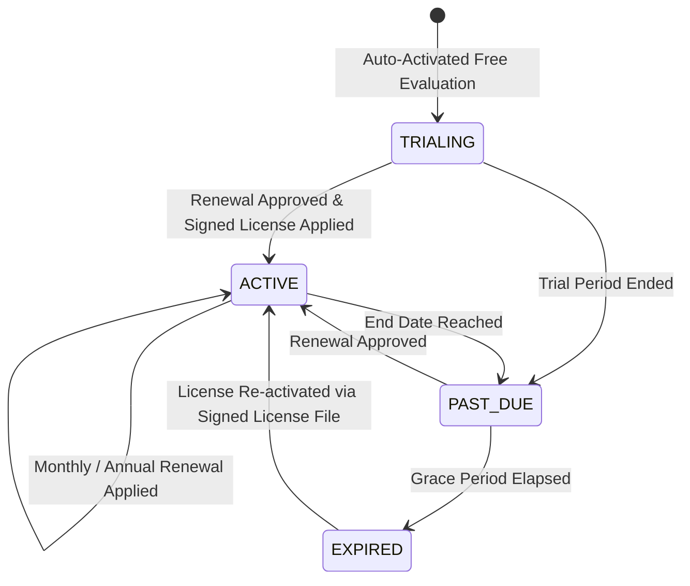

# MediHisaab — Client Subscription & Renewal Guide

This guide explains how subscriptions, counter licenses, grace periods, offline operations, and renewal workflows work for pharmacies running MediHisaab.

---

## 1. Core Principles: Offline-First & Data Sovereignty

MediHisaab is designed for mission-critical pharmacy operations:
* **Zero Cloud Dependency for Dispensing:** Fast barcode billing, medicine batch tracking, FEFO picking, expiry monitoring, and printing run completely offline on your local computer.
* **Local Data Storage:** All medicine records, customer credit (Khata), sale invoices, and purchase records are stored exclusively in your local SQLite database:
  `%LOCALAPPDATA%\PharmacyApp\data\pharmacy.db`
* **Data Guarantee:** Your local pharmacy database is **never** uploaded to any cloud server, and is **never deleted or locked out** if your subscription expires. Historical ledgers, tax registers, and audit trails remain permanently accessible for compliance inspections.

---

## 2. Subscription Tiers & Plans

| Plan | Counter Terminals | Billing Period | Target Pharmacy |
| :--- | :--- | :--- | :--- |
| **Trial Evaluation** | Up to 2 Counters | Configurable (4, 10, 15 Days Free) | New pharmacies evaluating the software. Automatically issued upon first launch signup. |
| **Monthly Standard Commercial** | Up to 2 Counters | Monthly | Standard neighborhood retail pharmacies preferring flexible monthly billing. |
| **Single Counter Standard** | 1 Counter | Annual | Standalone single-workstation retail pharmacies. |
| **Annual Standard Commercial** | Up to 2 Counters | Annual | Standard retail pharmacies requiring 2 concurrent counters on local LAN. |
| **Multi-Counter LAN** | Up to 5 Counters | Annual | Busy pharmacies with multiple concurrent billing counters over local Wi-Fi or Ethernet. |
| **Enterprise Pharmacy Suite** | Up to 20 Counters | Annual | High-volume hospital pharmacies and multi-terminal dispensaries. |

---

## 3. Subscription Lifecycle & Human-Readable Countdown

### 3.1 Status Countdown Display Format
The desktop app inspects the local signed Ed25519 license token and local system date on every launch, rendering clear status badges and headers:
* **Active Trial:** `Trial: 15 days remaining` (or configured 4, 10, 15 days).
* **Active Commercial Subscription:** `Subscription: 30 days remaining` (or `365 days remaining`).
* **Grace Period Warning:** `Grace Period: 5 days remaining — Renew soon to prevent billing interruptions`.
* **Expired Trial or Subscription:** `Trial expired — contact support to renew`.
* **Clock Tampering / Anomaly:** `System Clock Anomaly Detected — Device date appears set backwards. Please verify your computer time.`

### 3.2 Grace Period Policy
To prevent sudden operational halts in healthcare emergencies:
* **Trial Subscriptions:** Configurable vendor grace period (default 3 to 7 days).
* **Monthly Subscriptions:** Default 7-day grace period after the period end.
* **Annual Subscriptions:** Default 14-day grace period after the period end.

During the grace period:
* The system remains fully operational for routine dispensing, stock lookup, and printing.
* An amber alert banner appears in the application header with a direct **Contact Vendor / Renew** action.

### 3.3 Expired Status Safeguards
If a subscription remains un-renewed after the grace period expires:
* **Read-Only Preservation:** You retain full read-only access to customer Khata balances, historical invoices, and drug audit reports for tax and regulatory inspections.
* **Zero Ransomware / Zero Lockout:** No database files or records are ever encrypted, locked, or deleted.
* **Restoration:** Importing an updated signed license file instantly re-enables normal checkout operations.

---

## 4. Multi-Channel Renewal & Vendor Contact Workflow

When renewal is due or expired, click **Contact Vendor & Renew** from the header badge, login screen, or **Settings $\rightarrow$ License**:

1. **Direct Contact Channels:**
   * **Phone Support:** Configured vendor phone number (click to dial).
   * **WhatsApp Support:** Direct `wa.me` shortcut with prefilled store identity message for instant mobile or desktop chat.
   * **Email Support:** `mailto:` link with pre-populated client code and store name.

2. **In-App Renewal Request Submission:**
   * When internet is available, enter your requested plan (e.g. Monthly Standard or Annual Standard), payment reference (UPI UTR / NEFT reference), and notes.
   * The desktop app securely dispatches the request to the central licensing server without needing any email provider secrets on the client computer.
   * The server records the auditable request, alerts the vendor administrator via email, and confirms delivery status directly to the user.
   * If network is offline, the app displays vendor support contacts and allows retry.

3. **Vendor Approval & License Import:**
   * The vendor administrator reviews the payment reference in the Vendor Admin Portal (`/renewal-requests`).
   * Upon approval, the server generates a renewed cryptographically signed Ed25519 license.
   * The client downloads the `.json` license file or receives it via email/WhatsApp, and imports it in **Settings $\rightarrow$ License $\rightarrow$ Import License File**.
   * The application immediately verifies the cryptographic signature offline, refreshes the license countdown, and restores full operations.

